# Сверка

Приложение для iPhone и Android, которое переносит текст с фотографии в телефон и честно показывает, где оно могло ошибиться.

Наводишь камеру на что угодно — вывеску, экран, страницу книги, записку, справку — и сразу можешь скопировать текст, перевести его или найти опечатки. Всё это делается прямо на телефоне, без интернета. А строки, в которых распознавание не уверено, можно сверить с куском фото: приложение покажет, какие именно символы подозрительные.

| Мои тексты | Съёмка | Сразу после снимка | Сверка строки |
|---|---|---|---|
| 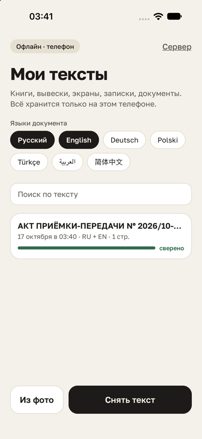 | 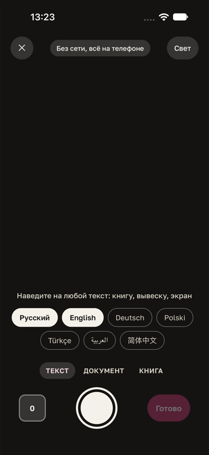 | 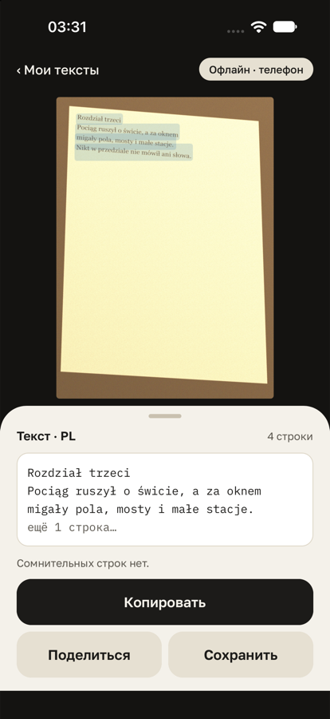 | 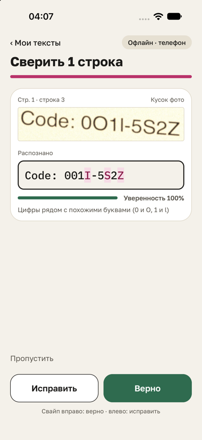 |

| Весь текст | Перевод (Android) | Опечатки | Экспорт |
|---|---|---|---|
| 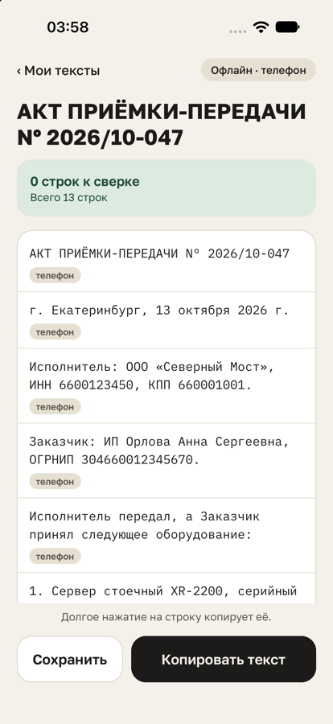 | 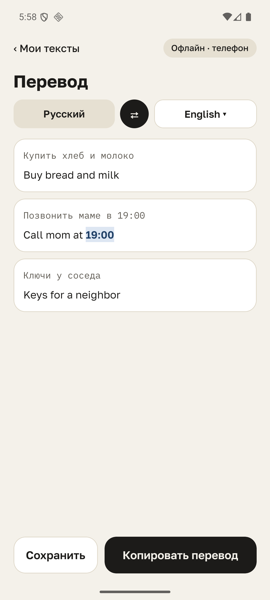 | 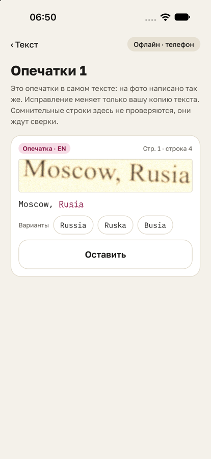 | 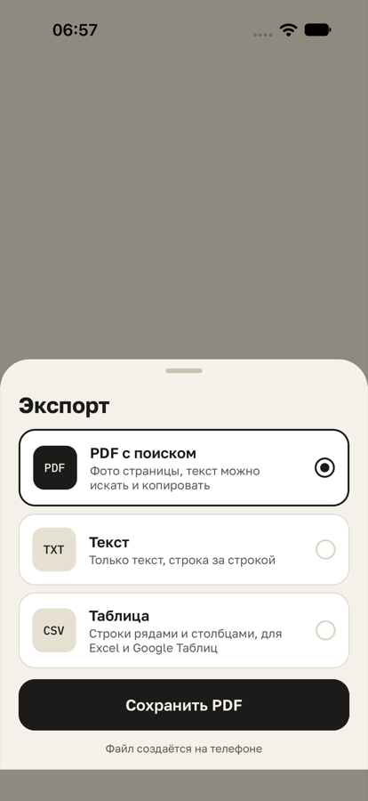 |

Скриншоты сняты на симуляторе iOS и эмуляторе Android. Фото на них — сгенерированные страницы из моего тестового набора.

## Зачем

Мобильные сканеры обычно отдают «готовый текст» и молчат о том, где ошиблись. Если переносишь номер договора, ИНН или сумму, приходится перечитывать всё глазами. Хорошие результаты лидеры получают, отправляя весь документ в облако. Мне хотелось наоборот:

- распознавать на телефоне, без сети;
- показывать только сомнительные строки рядом с куском фото;
- отправлять на сервер, только если человек сам захотел, и только вырезанные куски, а не всё фото.

Подробнее про идею и конкурентов — в `docs/research/`.

## Что умеет

- **Снять текст** в трёх режимах: «Текст» (как есть), «Документ» (системный сканер находит края листа и выравнивает его), «Книга». Можно снять несколько страниц подряд или взять фото из галереи.
- **Скопировать** весь текст одной кнопкой или одну строку долгим нажатием.
- **Сверить** сомнительные строки: кусок фото, текст с подсвеченными подозрительными символами (`0` и `О`, `1` и `l`), уверенность движка, другие варианты прочтения, свайп «верно» / «исправить».
- **Перевести** на телефоне абзацами, с подсветкой чисел, чтобы их было легко сверить с оригиналом.
- **Найти опечатки**, которые есть на самой бумаге, отдельно от ошибок распознавания.
- **Сохранить** в PDF с поиском по тексту, TXT или CSV (строки, стоящие рядами, раскладываются по столбцам).
- **Уточнить на своём сервере**: отмечаешь куски, видишь, что именно уйдёт, и только тогда отправляешь.

## Как это устроено

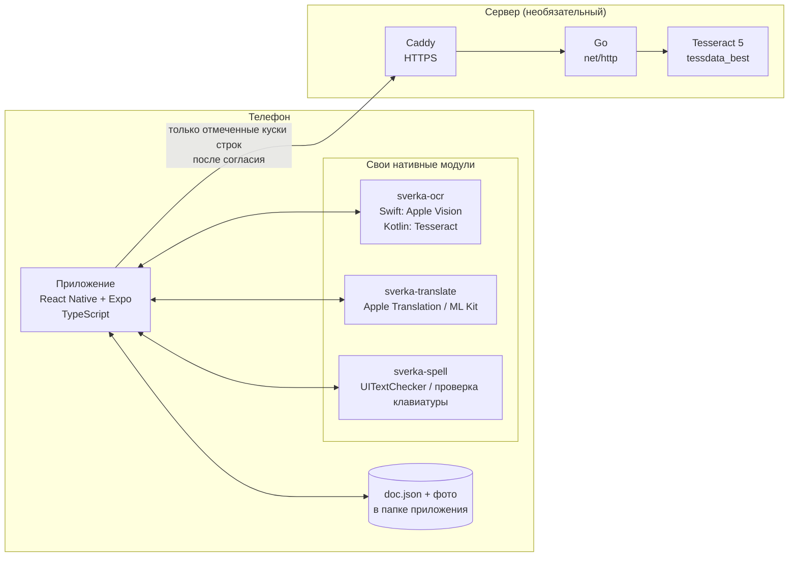

Путь одного снимка:

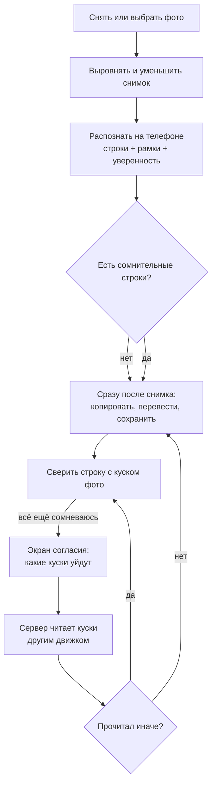

### Слои внутри приложения

Код в `app/src` разложен по Feature-Sliced Design. Каждый слой может брать только то, что ниже него, а части одного слоя не лезут друг в друга. За этим следит ESLint, так что случайно нарушить не получится.

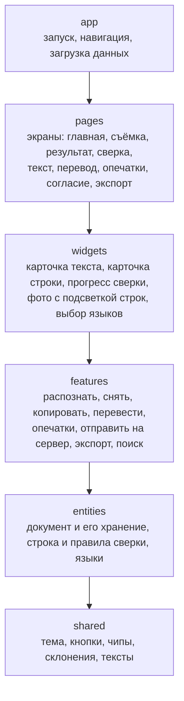

### Структура репозитория

```text
.
├── app/                      мобильное приложение
│   ├── src/                  TypeScript, слои FSD (см. схему выше)
│   ├── modules/
│   │   ├── sverka-ocr/       распознавание: Swift (Vision) и Kotlin (Tesseract4Android)
│   │   ├── sverka-translate/ перевод на телефоне
│   │   └── sverka-spell/     проверка опечаток
│   ├── e2e/                  сценарии Maestro для iOS и Android
│   ├── plugins/              плагины конфигурации Expo
│   └── scripts/              оценка правил сверки, скачивание моделей
├── backend/                  сервер на Go
│   ├── cmd/server/           точка входа
│   ├── cmd/eval/             подсчёт CER/WER по набору
│   ├── internal/api/         HTTP: лимиты, ключ, приём кусков, журнал
│   ├── internal/ocr/         пул клиентов Tesseract
│   ├── internal/limits/      лимит частоты
│   ├── internal/metrics/     CER и WER
│   └── Dockerfile
├── eval/                     стенд оценки качества
│   ├── synthetic/            генератор страниц и 43 картинки с эталоном
│   ├── camera/               снимки «любого текста»
│   └── results/              результаты замеров
├── deploy/Caddyfile          HTTPS перед сервером
├── docker-compose.yml
└── docs/                     API, качество, приватность, запуск, исследование
```

## Стек

| часть | что использую |
|---|---|
| Приложение | React Native 0.86, Expo SDK 57, TypeScript, zod |
| Распознавание | Apple Vision (iOS), Tesseract 5 через Tesseract4Android (Android) |
| Перевод | Apple Translation (iOS 18+), ML Kit (Android) |
| Опечатки | UITextChecker (iOS), системная проверка правописания (Android) |
| PDF | pdf-lib: фото страницы и невидимый текстовый слой поверх строк |
| Сервер | Go 1.26, net/http, gosseract, Caddy, Docker |
| Тесты | `node:test`, `go test`, Maestro для e2e |
| Качество кода | ESLint (правила стилей React Native и границ слоёв), knip, staticcheck |

## Насколько хорошо распознаёт

Я сделал свой стенд: программа рисует страницы на 7 языках и портит их (наклон, перспектива, темнота, смаз), а потом считает долю ошибочных символов.

| | iPhone (Vision) | Android (Tesseract) |
|---|---|---|
| Русский, хорошие снимки | 1,2–1,4 % | 1,9–3,6 % |
| Английский, хорошие снимки | 0,3–0,7 % | 0,1–2,8 % |
| Польский, хорошие снимки | 0,4–0,7 % | 0,1–2,6 % |
| Русский, темно и смазано | 3–4,5 % | около 50 % |

Самое неожиданное, что я узнал: уверенность Vision почти бесполезна — у строки она бывает только 1,0, 0,5 или 0,3, и ошибки встречаются даже при 1,0. Поэтому правило «что сверять» пришлось собирать из нескольких сигналов. Все числа синтетические и сняты на Mac. Подробности и таблицы по языкам — в [docs/quality.md](docs/quality.md).

## Приватность

Текст и фото не покидают телефон, пока ты сам не нажмёшь «Отправить», и даже тогда уходят только отмеченные куски строк. Нет аккаунтов, рекламы и аналитики. Сервер ничего не хранит и пишет в журнал только метод, код ответа, длительность и число кусков. Как это устроено и как я это проверял — в [docs/privacy.md](docs/privacy.md).

## Запуск

```bash
cd app
npm install
npx expo run:ios          # или npx expo run:android (перед этим npm run fetch:tessdata)
```

```bash
cd backend
export SVERKA_TOKEN=$(openssl rand -hex 32)
make run                  # нужен brew install tesseract и модели в .tessdata/
```

Проверки:

```bash
cd app && npm test && npm run typecheck && npm run lint
```

```bash
cd backend && make test && make lint
```

Всё по шагам, включая Docker и e2e, — в [docs/run.md](docs/run.md). Описание API сервера — в [docs/api.md](docs/api.md).

## Что дальше

- Проверить всё на настоящих телефонах и настоящих фото, а не только на сгенерированных.
- Таблицы через `RecognizeDocumentsRequest` на iOS 26.
- Иконки и тёмная тема.
- Фильтры «С опечатками» и «Переведённые» на главной.

## Лицензии сторонних частей

Tesseract и модели tessdata_best — Apache 2.0, gosseract — MIT, шрифты Golos Text и IBM Plex Mono — SIL OFL 1.1, JS-зависимости — MIT. Полный список есть в самом приложении на экране «О программе».
