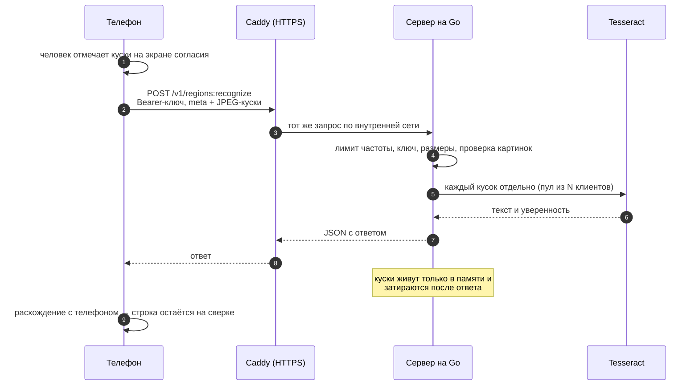

# API сервера

Сервер нужен только для одного: уточнить строки, в которых телефон сомневается. Приложение отправляет на него вырезанные куски строк — никогда не целое фото — и получает в ответ, как их прочитал Tesseract.



## `POST /v1/regions:recognize`

`multipart/form-data`, заголовок `Authorization: Bearer <ключ>`.

- часть `meta` — JSON: `{"languages": ["rus", "eng"], "regions": [{"id": "p0-3"}, {"id": "p0-7"}]}`
- части с именами из `regions[].id` — PNG или JPEG одного куска.

Ответ `200`:

```json
{
  "success": true,
  "data": {
    "engine": "tesseract-5.5.3",
    "regions": [{ "id": "p0-3", "text": "ИНН 6600123450", "confidence": 0.91 }]
  },
  "error": null
}
```

## Ограничения

| что | предел |
|---|---|
| кусков в запросе | до 20 |
| размер куска | до 1 МБ и 4000×1000 точек |
| весь запрос | до 10 МБ |
| языки | до 5, только установленные на сервере (`GET /v1/languages`) |
| id куска | `[A-Za-z0-9_-]{1,32}` |
| частота | 60 кусков в минуту с одного адреса (IPv6 — по /64), запас 40 |
| одновременных запросов | 2 × число потоков распознавания |

## Ошибки

Все ошибки приходят в одном формате: `{"success": false, "data": null, "error": {"code": "...", "message": "..."}}`. Содержимое кусков в ошибки не попадает.

| код HTTP | `error.code` | когда |
|---|---|---|
| 400 | `invalid_request` | битый `meta`, неизвестный язык, плохой id, не PNG/JPEG |
| 401 | `unauthorized` | нет ключа или чужой ключ |
| 405 | `method_not_allowed` | не тот метод |
| 413 | `too_large` | кусок или запрос больше предела |
| 429 | `rate_limited` | слишком часто |
| 503 | `busy` | сервер занят |
| 503 | `timeout` | не успел распознать, лучше отправить меньше кусков |
| 500 | `internal_error` | всё остальное, без подробностей |

## Остальное

- `GET /v1/languages` — установленные языки и версия движка.
- `GET /healthz` — для проверки, что сервер жив.

## Что сервер пишет в журнал

Только метод, код ответа, длительность и число кусков. Ни текста, ни картинок, ни ключа. На диск сервер ничего не пишет. Это проверяется тестом в `backend/internal/api/middleware_test.go`.
