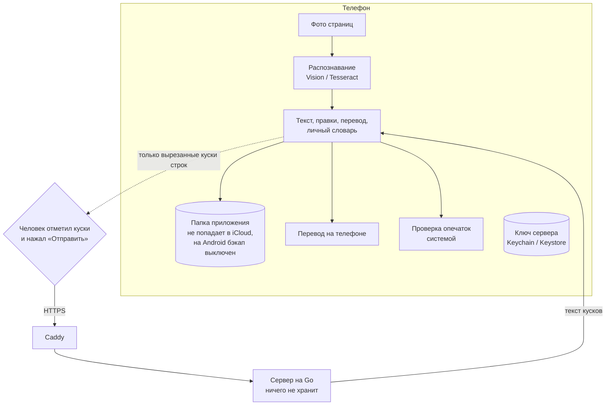
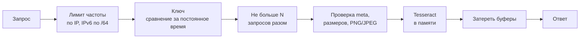

# Приватность и безопасность

Главное правило проекта: текст и фото остаются на телефоне, пока человек сам не решит иначе. Ниже — как это устроено и как я это проверял.

## Куда могут уйти данные

- Без действия человека с телефона не уходит ничего: нет аккаунтов, аналитики и рекламы.
- На сервер уходят только отмеченные на экране согласия куски строк (JPEG) и коды языков. Целое фото — никогда. Перед каждой пачкой согласие проверяется заново.
- Перевод: на iPhone — системный перевод Apple (iOS 18+), на Android — ML Kit. Текст не отправляется, языковой пакет телефон скачивает один раз.
- Опечатки: на iPhone — системные словари iOS, на Android — проверка правописания клавиатуры.
- Ключ сервера лежит в Keychain / Keystore, `http://` разрешён только для localhost в отладочной сборке.

Политика конфиденциальности, которую видит человек, лежит в `app/src/shared/content/privacy.ts` и открывается из настроек и с экрана согласия.

## Сервер

- Тело запроса читается потоком с жёсткими пределами, картинки декодируются в Go до передачи в Tesseract, на диск ничего не пишется.
- В журнал попадают только метод, код, длительность и число кусков. Журнал Caddy выключен — в нём были бы IP-адреса.
- Контейнер: пользователь без прав root, корневая ФС только для чтения, все capabilities сняты, внутренний порт наружу не опубликован, модели скачиваются с закреплённого коммита и сверяются по sha256.

## Как проверял

| проверка | результат |
|---|---|
| `npm audit --omit=dev` | находки только в инструментах сборки Expo (braces, node-forge, uuid); в собранное приложение эти пакеты не попадают — проверил по бандлу |
| `govulncheck` | на Go 1.26.1 было 23 уязвимости стандартной библиотеки, перевёл сервер на Go 1.26.9 — уязвимостей нет |
| Поиск секретов в коде и истории | только тестовые ключи в тестах |
| Живой сервер в Docker за Caddy | без ключа и с чужим — 401; GET — 405; не картинка и плохой id — 400; 12 МБ — 413; из 80 запросов подряд 42 получили 429; в журнале нет ни текста, ни ключа |
| Тест журнала | `backend/internal/api/middleware_test.go`: в журнал не попадает содержимое |
| doc.json на телефоне | схема zod с пределами размеров; имена файлов и id строк без `..` и слешей |
| Экспорт CSV | ячейки, начинающиеся с `= + - @`, экранируются, чтобы Excel не выполнил их как формулы |

## Для магазинов приложений

- App Store, App Privacy: **Data Not Collected**, Tracking — нет. Куски, которые человек сам отправляет на сервер, сервер не хранит.
- Google Play, Data safety: данные не собираются и не передаются третьим лицам; передача зашифрована; удалить данные можно в приложении. ML Kit при первом переводе скачивает языковую модель с серверов Google, текст при этом не уходит.
