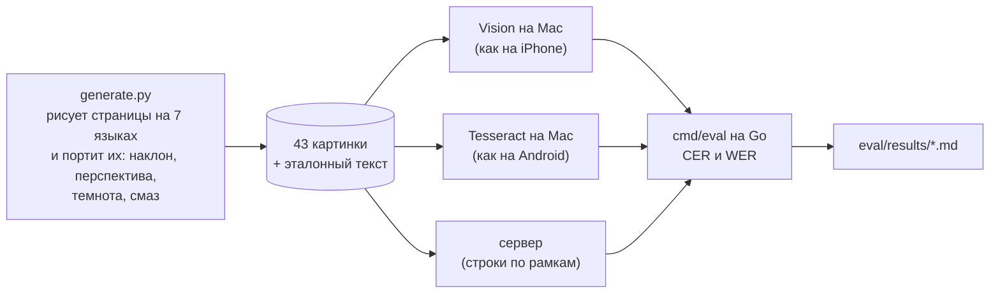

# Качество распознавания

Мне было важно не просто «оно как-то распознаёт», а понимать цифрами, где приложение ошибается. Для этого в репозитории есть свой маленький стенд оценки.

## Как я мерил

- **CER** — доля символов с ошибкой (расстояние Левенштейна по символам Unicode). **WER** — то же по словам. Перед сравнением текст нормализуется: NFC, лишние пробелы. Регистр и пунктуация не трогаются — путаница `0`/`О` и `1`/`l` как раз то, что приложение должно ловить.
- Набор синтетический: страницы нарисованы программой, всё в них выдумано. Это удобно (есть точный эталон), но настоящие фото с телефона могут вести себя иначе.
- Отдельно `eval/camera` — 6 снимков «любого текста» (вывеска, экран, книга, записка, справка, справка с опечатками), чистые и «как с телефона».

## Какие строки отправлять на сверку

Самое интересное оказалось тут. Уверенность Vision почти бесполезна: на строку она бывает только 1,0, 0,5 или 0,3, и ошибки встречаются даже при 1,0. Поэтому строка попадает на сверку, если:

- уверенность движка ниже порога (Vision — ниже 1,0; Tesseract — ниже 0,9, подобрано на наборе скриптом `app/scripts/eval-tesseract-threshold.ts`);
- в строке есть «опасный токен» — цифры вперемешку с похожими буквами (`SN-7B0O-1l5I`, `66О0123450`);
- сервер прочитал строку иначе, чем телефон.

| | строк в очереди | поймано строк с ошибкой |
|---|---|---|
| iOS, хорошие снимки | 14 % | 46 % |
| Android (порог 0,9), хорошие снимки | 34 % | 64 % |

Таблицы целиком: `eval/results/day2-review-rule.md` и `eval/results/day5-tesseract-threshold.md`.

## Языки

Все числа — синтетика, Mac, не телефон: страницы отрендерены программой (`eval/synthetic`), Vision запускался на macOS 26, Tesseract 5.5.3 tessdata_best на Mac (на Android стоит Tesseract 5.5.1 с теми же моделями). Число — CER, доля символов с ошибкой. «Хорошие» — чистая страница, скан с наклоном, фото с перспективой; «плохие» — недосвет и смаз. На настоящих телефонах и настоящих фото я это ещё не мерил — это следующий шаг.

### Русский, английский, польский

| | iOS, офлайн (Vision) | Android, офлайн (Tesseract на устройстве) | Сервер (Tesseract, строки по рамкам) |
|---|---|---|---|
| **ru**, хорошие снимки | 1,2–1,4 % | 1,9–3,6 % (страница целиком) | 1,9–2,2 % |
| **ru**, плохой свет и смаз | 3,0–4,5 % | 50 % | 42–50 % |
| **en**, хорошие | 0,3–0,7 % | 0,1–2,8 % | 0,1–0,4 % |
| **en**, плохие | 1,7–2,1 % | 2,4–31 % | 13–16 % |
| **pl**, хорошие | 0,4–0,7 % | 0,1–2,6 % | 0,1–1,5 % |
| **pl**, плохие | 6,8–7,9 % | 44–65 % | 7,7–31 % |
| Модель в приложении | встроена в iOS | rus, eng, pol (tessdata_best, проверены sha256) | rus, eng, pol и другие |
| Перевод на телефоне | Apple Translation, iOS 18+ (на устройстве не проверено) | ML Kit — проверено на эмуляторе (ru → en) | нет |
| Проверка опечаток | UITextChecker: ru, en, pl — проверено на симуляторе | системная проверка клавиатуры — на эмуляторе не находит опечаток | нет |

### Остальные языки распознавания (только распознавание)

| язык | iOS, хорошие / плохие | Tesseract на Mac, хорошие / плохие | Сервер, хорошие / плохие |
|---|---|---|---|
| de | 0,3–0,4 % / 4,4–41 % | 0,4–5,1 % / 71–86 % | 0,4–0,6 % / 32–75 % |
| tr | 0,4–0,5 % / 4,8–14 % | 0,7–15 % / 35–58 % | 0,7–1,3 % / 41–44 % |
| ar | 2,8–3,3 % / 6,1–8,6 % | 9,4–29 % / 24–65 % | 9,4–9,5 % / 12–20 % |
| zh (упрощённый) | 0,9–1,8 % / 2,1–12 % | 6,1–38 % / 12–93 % | 4,3–5,5 % / 9,8–82 % |
| be, kk | нет в Vision | на сервере есть модели, не измерено | не измерено |

Что из этого следует: на iOS распознавание на телефоне точнее сервера на всех языках, кроме английского на хороших снимках. На Android телефон и сервер — один и тот же движок, плохие снимки он читает плохо, поэтому на Android важнее переснять, чем отправлять на сервер. Польская модель добавлена в APK 19.10 (12 МБ); на эмуляторе сгенерированная страница книги на польском распознана с диакритикой («Rozdział», «świcie», «słowa»), одна строка разбита Tesseract на две.

Полные таблицы: `eval/results/day1-vision-macos.md`, `day1-tesseract-mac.md`, `day2-backend.md`.
